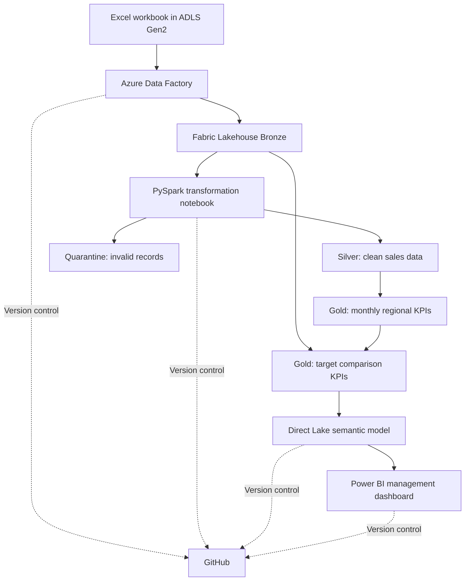

# Azure-to-Microsoft Fabric Sales Data Platform

An end-to-end data engineering portfolio project demonstrating Azure Data Factory ingestion, Microsoft Fabric Lakehouse architecture, PySpark data quality and transformation, Gold KPI modelling, Power BI reporting, and Git-based version control.

> **Portfolio disclaimer:** This project uses sample/synthetic sales data for demonstration. The reported results are not actual company financial results.

## Project Overview

The platform ingests sales and reference data from an Excel workbook stored in Azure Data Lake Storage Gen2, processes it through Bronze, Silver, and Gold layers in Microsoft Fabric, and presents business performance through a Power BI management dashboard.

## Architecture



## Technology Stack

- **Azure:** Azure Data Lake Storage Gen2 and Azure Data Factory
- **Microsoft Fabric:** Lakehouse, PySpark notebooks, Delta tables and Direct Lake semantic modelling
- **Reporting:** Power BI, DAX measures, KPI cards, line and column charts, and report slicers
- **Version control:** GitHub and Microsoft Fabric Git integration
- **Infrastructure and CI/CD:** Azure resource deployment definitions and Azure Data Factory Git integration

## Key Capabilities

### 1. Data Ingestion

- Ingest the sales dataset using the `pl_ingest_sales` pipeline.
- Load Customers, Products, and SalesTargets reference data using `pl_ingest_reference_data`.
- Store source data in the Fabric Lakehouse Bronze layer.
- Use repeatable Copy activity configurations for reference-data ingestion.

### 2. Data Quality and Transformation

The `nb_sales_silver_transform` notebook implements the Silver and Gold transformations.

- Remove exact duplicate sales records.
- Quarantine records with missing required identifiers.
- Convert relevant date and numeric fields to appropriate data types.
- Validate cleaned data and reconcile Gold aggregates against Silver results.

### 3. Gold Analytics

The project creates monthly and regional sales metrics and combines them with sales targets.

Key Gold tables:

- `sales_gold.monthly_regional_kpis`
- `sales_gold.monthly_regional_target_kpis`

The target comparison model retains target periods without actual sales so they are not incorrectly interpreted as zero-sales results.

### 4. Management Dashboard

The `Sales Management KPI Dashboard` provides:

- Total Revenue
- Total Profit
- Target Achievement %
- Target Variance
- Monthly Revenue versus Sales Target
- Regional Revenue versus Sales Target
- Month and Region slicers

The report uses the `sm_sales_management_kpis` semantic model.

## Validation Results

The following results were observed during the project validation run.

| Validation | Result |
|---|---:|
| Source sales rows | 2,001 |
| Exact duplicate records removed | 1 |
| Quarantined sales records | 2 |
| Clean Silver sales rows | 1,998 |
| Customers loaded to Bronze | 300 |
| Products loaded to Bronze | 60 |
| SalesTargets loaded to Bronze | 180 |
| Monthly regional KPI rows | 105 |
| Target comparison KPI rows | 180 |
| Duplicate month-region keys in target Gold table | 0 |
| Reference-data pipeline | 3 of 3 Copy activities succeeded |

The target comparison table contains 105 month-region rows with actual sales and 75 target-only rows. The target table has 180 records and no duplicate month-region keys.

## Repository Structure

```text
azure-fabric-sales-data-platform/
├── dataset/
├── factory/
├── linkedService/
├── pipeline/
├── Fabric/
│   ├── Sales Management KPI Dashboard.Report/
│   ├── lh_sales_bronze.Lakehouse/
│   ├── nb_sales_silver_transform.Notebook/
│   ├── sm_sales_management_kpis.SemanticModel/
│   └── Readme.md
├── README.md
└── publish_config.json
```

Azure Data Factory definitions are maintained in the ADF project folders. Fabric workspace definitions are synchronized to the `fabric-dev` branch under `Fabric/`.

## Execution Workflow

1. Place the source workbook in the configured ADLS Gen2 landing path.
2. Configure the Azure Data Factory linked services, identities, and access permissions.
3. Run `pl_ingest_sales` and `pl_ingest_reference_data`.
4. Verify the Bronze tables in the Fabric Lakehouse.
5. Run `nb_sales_silver_transform` to produce and validate Silver and Gold data.
6. Verify the Gold target comparison table and its month-region keys.
7. Open the Power BI report and validate the KPI cards, charts, and slicer interactions.
8. Review Git status and commit workspace changes through Fabric Git integration.

## Important Data Considerations

- September 2026 sales data was observed through September 15 only. September results are partial and should not be compared directly with a full-month target without an appropriate completeness rule.
- Monetary values in the report currently use the configured dollar currency format. Confirm the intended business currency before reusing the report with other data.
- Results and row counts reflect the dataset and validation run at the time of testing.

## Security and Configuration

- Never commit GitHub personal access tokens, passwords, client secrets, or other credentials.
- Prefer managed identities and secure secret management where supported.
- Review linked service definitions and deployment configuration before publishing repository changes.
- Restrict repository permissions to the minimum access required.

## Future Enhancements

- Add automated pipeline scheduling and failure notifications.
- Add month-completeness and late-arriving-data handling.
- Extend the semantic model with customer-segment and product-category analysis.
- Add automated reconciliation checks and deployment validation.
- Add a documented environment promotion process for development and production.

## Author

**Soeb Diwan**

Azure and Microsoft Fabric data engineering portfolio project.

